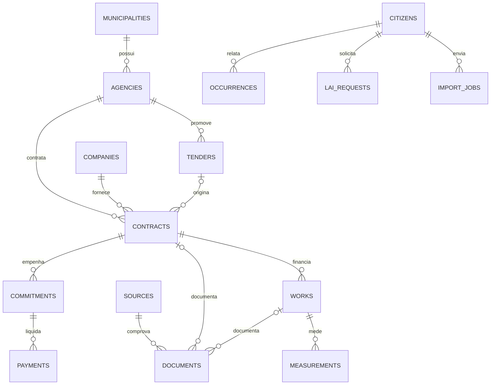

# Arquitetura

## Decisões

Monólito modular Next.js 16 + React + TypeScript, Tailwind CSS 4, PostgreSQL/Supabase, Leaflet/OpenStreetMap e coletor Python. Nenhuma tecnologia preferencial foi substituída. PGlite executa PostgreSQL embarcado **somente nos testes**; não substitui o Supabase no produto.

A aplicação é independente de outros projetos. Git já estava inicializado no checkout vazio exclusivo do Observatório. Não foi feito push, deploy, criação de serviço pago ou alteração em Wilmotos.

Server Components compõem páginas. Componentes cliente ficam restritos a filtros, formulários, mapa e registro do service worker. API routes validam entradas com Zod e usam a sessão Supabase do usuário, nunca uma chave que ignore RLS. Camada SQL é a autoridade para autorização, integridade e auditoria. Nenhuma seleção de perfil no cliente concede privilégios.

A base demonstrativa em `lib/data.ts` é separada dos registros oficiais e não é inserida no banco. Enquanto não houver importação oficial revisada, a UI pública permanece demonstrativa. Contas, LAI, ocorrências e quarentena de arquivos usam persistência real apenas quando configurada.

## Módulos

| Módulo                      | Núcleo inicial                                      | Extensão futura                                                 |
| --------------------------- | --------------------------------------------------- | --------------------------------------------------------------- |
| Transparência financeira    | Dashboard fictício; empenhos e pagamentos no modelo | Séries históricas e execução orçamentária real                  |
| Obras                       | Busca, filtros, detalhe, mapa; medições no modelo   | Histórico importado e georreferenciamento validado              |
| Licitações e contratos      | Consulta fictícia e tabelas normalizadas            | Adaptadores PNCP e TCE                                          |
| Fiscalização cidadã         | Cadastro privado, foto, revisão de texto            | Consulta pública de relatos moderados e recursos                |
| LAI                         | Rascunho, acompanhamento de status e protocolo      | Respostas, prazos e anexos; envio oficial depende de integração |
| Saúde                       | Assunto compartilhado                               | Indicadores e metodologia próprios                              |
| Educação                    | Assunto compartilhado                               | Indicadores e metodologia próprios                              |
| Funcionalismo/administração | Órgãos no modelo                                    | Dados agregados com análise LGPD                                |
| Meio ambiente/urbanismo     | Assunto compartilhado                               | Camadas geográficas e indicadores                               |
| Inteligência/relatórios     | Valores agregados demonstrativos                    | Relatórios versionados; IA sempre identificada como hipótese    |

## Modelo relacional

Tabelas oficiais mantêm `source_id`, `external_id`, `collected_at`, `verified` e unicidade por fonte/identificador. Documentos preservam URL original e SHA-256. UUIDs identificam entidades; valores financeiros são `numeric(18,2)`, não floats no banco. Município é derivado de órgão/contrato para obras e pagamentos. Empresas podem atuar em múltiplos municípios. Registros de participação podem futuramente associar município e obra; o protótipo só oferece Pelotas.

Papéis iniciais são globais ao projeto. Antes de hospedar equipes de municípios diferentes, adicionar escopo municipal às atribuições e testes de isolamento entre equipes. Leituras públicas de dados oficiais são limitadas a `verified=true`; pessoal autorizado revisa a área de preparação. O painel público demonstrativo não mistura essas consultas com fixtures.

Auditorias registram ator, entidade, identificador, ação e data, sem copiar descrições ou credenciais. Revisor/admin moderam via função SQL; cidadão acompanha LAI via função restrita ao proprietário. O histórico de revisão completo com versões de conteúdo fica para a próxima etapa.

## Importação e tarefas agendadas

Fluxo: obtenção autorizada → arquivo privado → hash e validação → JSON em revisão → normalização relacional → revisão humana → leitura oficial. Foram implementadas as etapas até preparação/revisão; a promoção relacional e os adaptadores de rede aguardam fontes verificáveis.

O CLI Python retorna código diferente de zero em erros, recusa sobrescrita e não modifica o banco. Pode ser chamado por cron ou fila posteriormente. Nenhum agendamento foi ativado. Adaptadores devem ter limites de tempo, paginação limitada, backoff, checkpoints e testes de contrato com amostras oficiais.

## PWA e execução

Aplicação responsiva com manifesto, ícones PNG e fallback offline. Não armazena páginas privadas em cache nem simula envio offline. Servidor local escuta somente loopback por padrão. HTTPS, CSP com nonce, limitação distribuída de requisições, observabilidade, backups e recuperação precisam de configuração antes de produção.
